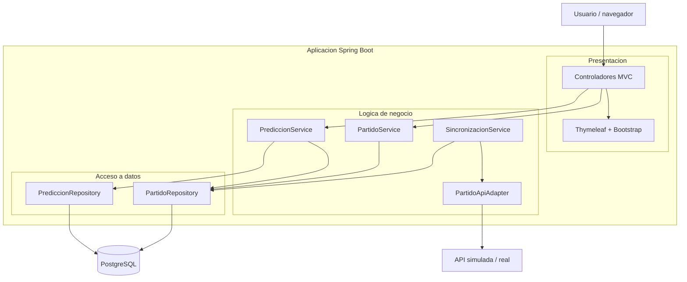

# Champions Predictions — Aplicación en 3 capas

Aplicación web para la **gestión de partidos de la Champions League** y el
registro de **predicciones**, construida con arquitectura en **3 capas**
(Presentación, Lógica de Negocio y Acceso a Datos), Dockerizada para ejecutarse
en local con `docker compose`.

- Al iniciar, **sincroniza** los partidos desde una **API real** (football-data.org, Champions League) hacia **PostgreSQL**.
- Lista los partidos almacenados y permite **registrar predicciones** (ganador + marcador) con validación.
- Permite **consultar** todas las predicciones registradas.

## Arquitectura en 3 capas



| Capa | Paquete | Responsabilidad |
|------|---------|-----------------|
| Presentación | `presentation/` | Controladores MVC y plantillas Thymeleaf. No accede a la BD. |
| Lógica de negocio | `business/` | Servicios (partidos, predicciones, sincronización) y adaptador de API. Validaciones. |
| Acceso a datos | `data/` | Entidades JPA y repositorios Spring Data. |

## Modelo de datos

```text
PARTIDO (partidos)                 PREDICCION (predicciones)
------------------                 -------------------------
id            PK                   id             PK
origen                             partido_id     FK -> partidos.id
id_externo                         resultado_esperado  LOCAL|EMPATE|VISITANTE
equipo_local                       goles_local
equipo_visitante                   goles_visitante
fecha_hora                         fecha_registro
fase
estado
goles_local     (nullable)
goles_visitante (nullable)

UNIQUE (origen, id_externo)  -> evita duplicados al re-sincronizar
```

## Flujo de datos

**Al iniciar la aplicación** (`SincronizacionRunner`):
1. `SincronizacionService` pide los partidos al `PartidoApiAdapter` (real por defecto: football-data.org).
2. Hace **UPSERT** por `(origen, id_externo)`: inserta nuevos, actualiza existentes. Nunca borra (conserva las predicciones).
3. Guarda el resultado de la sincronización (para el panel).

**Al registrar una predicción**:
```
Formulario → PrediccionController → PrediccionService
   → valida que el resultado coincida con el marcador
   → PrediccionRepository → PostgreSQL → confirmación en la UI
```

## Requisitos

- Docker Desktop (para la opción con contenedores), o
- JDK 21 + PostgreSQL (para la opción local).

## Ejecución con Docker (recomendada)

Primero copia `.env.example` a `.env` y coloca tu **token** de football-data.org
en `MATCH_API_TOKEN` (obligatorio en modo `real`). Luego, desde la carpeta del
proyecto:

```bash
docker compose up --build
```

Esto construye la imagen de la app, levanta PostgreSQL con un volumen
persistente y arranca todo. Cuando veas `Started ChampionsApplication`, abre:

**http://localhost:8080**

Detener: `Ctrl + C`. Limpiar (conservando datos): `docker compose down`.
Borrar también los datos: `docker compose down -v`.

### Variables de entorno

Se definen en `docker-compose.yml` y pueden sobreescribirse con un archivo
`.env` (ver `.env.example`):

| Variable | Finalidad | Valor por defecto |
|----------|-----------|-------------------|
| `DB_NAME` | Nombre de la base de datos | `champions_db` |
| `DB_USER` | Usuario de PostgreSQL | `postgres` |
| `DB_PASSWORD` | Contraseña | `postgres` |
| `DB_HOST` / `DB_PORT` | Host/puerto de la BD (la app → `db:5432`) | `db` / `5432` |
| `MATCH_API_MODE` | Fuente de partidos: `real` o `simulado` | `real` |
| `MATCH_API_TOKEN` | **Token de football-data.org** (obligatorio en modo `real`) | *(vacío)* |
| `MATCH_API_COMPETITION` | Competición (CL = Champions League) | `CL` |
| `APP_PORT` | Puerto de la app en el host | `8080` |

### Persistencia

Los datos de PostgreSQL viven en el volumen nombrado `champions_pgdata`.
Las predicciones **sobreviven** a recrear los contenedores mientras no se borre
el volumen (`docker compose down` sin `-v`).

## Ejecución local (sin Docker)

```bash
# 1. Crear la base (Windows / PostgreSQL 18)
$env:PGPASSWORD='TU_CONTRASEÑA'; & 'C:\Program Files\PostgreSQL\18\bin\psql.exe' -U postgres -h localhost -c "CREATE DATABASE champions_db;"

# 2. Ajustar la contraseña por defecto en application.properties si hace falta

# 3. Ejecutar
.\mvnw.cmd spring-boot:run     # Windows
./mvnw spring-boot:run         # Linux/Mac
```

Abrir **http://localhost:8080**.

## Estructura del proyecto

```text
parte01/
├── Dockerfile
├── docker-compose.yml
├── .dockerignore
├── .env.example
├── pom.xml
└── src/main/
    ├── java/com/proyecto/champions/
    │   ├── presentation/controller/
    │   ├── business/            (service/ + integration/ + SincronizacionRunner)
    │   └── data/                (entity/ + repository/)
    └── resources/
        ├── application.properties
        ├── static/css/ · static/js/
        └── templates/           (dashboard, partidos, predicciones)
```

## Notas

- Por defecto consume la **API real** de football-data.org (`origen = FOOTBALL_DATA`).
  Requiere un **token gratuito** (`MATCH_API_TOKEN`): regístrate en
  <https://www.football-data.org/client/register>.
- Como respaldo para probar **sin token**, existe `MATCH_API_MODE=simulado`, que
  usa partidos ficticios en código (`origen = SIMULADO`).
- El despliegue en la nube (AWS) y la publicación de la imagen se documentan aparte.
